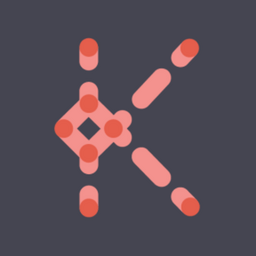
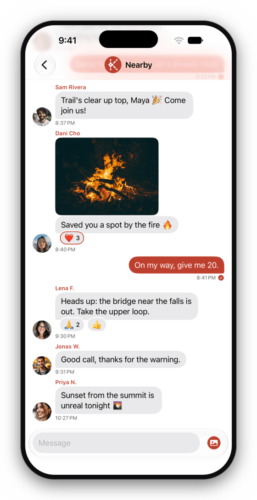

<div align="center">



# Knit for iOS

**Message the people around you when there is no network at all, from an iPhone.**

Phones in range link over Bluetooth LE and relay for one another, so a message reaches people you were never
in range of yourself. There is no server, no account and no phone number.

[](https://github.com/getknit/knit-ios/actions/workflows/ci.yml)




<sub>The <b>Nearby</b> room: posts and photos from everyone in Bluetooth range, with no network.</sub>

</div>

---

## About

Knit for iOS is the iPhone port of [Knit](https://github.com/getknit/knit), the offline mesh messenger for
Android. An iPhone speaks the same protocol as Knit for Android, so the two link directly and relay for each
other on one mesh.

Version 1.0.0 is headed for the App Store and has not been released yet. Everything below is in that build.

## Features

- **The Nearby room** is an open chat for everyone in range. Posts are signed, so nobody can post as you,
  but they are not encrypted, and neither are the photos posted there.
- **Direct messages** are end-to-end encrypted, and so are their photos. The phones that carry them cannot
  read them, and between up-to-date phones Knit keeps replacing the keys, so keys stolen later don't open
  what was sealed under the ones it replaced.
  Messages from people you haven't chatted with wait in Requests until you accept them.
- **Groups** of up to eight people are end-to-end encrypted too. Start one with anyone you've chatted with or
  verified, then rename it or leave it. Groups started on Android phones work as well.
- **Send photos in any chat** and save the ones you receive. GIFs and animated stickers play, and you can
  react to a message with one of six emoji.
- **Verify people in person** by scanning their code with the camera or comparing safety numbers. It works
  with Android phones too.
- **Block or report someone** from their profile, a message or a request. Content filtering runs on the
  iPhone itself: it hides explicit photos and abusive messages from other people until you tap them, and
  won't send explicit photos or abuse to Nearby from your iPhone.
- **Knit stays readable at the largest text sizes,** and its text and buttons meet WCAG AA contrast.

## How it works

Every phone running Knit is a node. Phones in range link over Bluetooth LE and pass each message from one to
the next. A phone that meets someone later hands over what it was carrying for them, so messages sent while
you are out of range wait on the phones around you, for up to a day, until you are back.

Knit for Android also meshes over Wi-Fi Aware, LoRa boards and internet relays. An iPhone reaches those parts
of the mesh through the Android phones around it.

### On iPhone, in the background

Knit's open links keep running when it's in the background. iOS doesn't let other phones discover a
backgrounded app, though, and suspends it until something wakes it, so Knit finds new people while it's open.

- **It reconnects on its own.** When your iPhone loses its last link, Knit looks for nearby phones and
  reconnects to the first one it can, without being opened. If the phones it finds won't connect, it stops
  after a few tries and waits until you open it.
- **Some phones wake it.** Newer builds of Knit for Android wake Knit when they have a message for you, and it
  arrives within seconds with a notification. Messages from a phone that can't wake Knit wait on the link
  until you next open it.

## Security

- Direct messages and group messages are end-to-end encrypted, and so are their photos.
- Between phones running Knit for iPhone or Knit for Android 2.3 and later, they also have forward secrecy.
  Knit keeps replacing the keys and deletes the old ones, so someone who later takes a phone's keys can't open
  messages they recorded before those keys were replaced. Reactions and delivery ticks are sealed the same way.
  [`SECURITY.md`](SECURITY.md) lists the exceptions.
- With a phone on an older version, and in a group that includes one, messages use Knit's earlier
  static-key scheme, which has no forward secrecy, and reactions travel unencrypted.
- A group's name and member list travel unencrypted, and so do typing indicators.
- The Nearby room is public: everyone in range can read it.

Report vulnerabilities privately, as [`SECURITY.md`](SECURITY.md) describes. It also lists the limits that
are known and deliberate.

## Requirements

- An iPhone running iOS 18 or later, with Bluetooth on.
- Other people nearby running Knit, on iPhone or Android.

## Build

Knit for iOS is one Swift package. The protocol code builds and tests on Linux and macOS. The app itself
builds on a Mac with Xcode, from a project that [XcodeGen](https://github.com/yonaskolb/XcodeGen) generates.

You need Swift 6.4 (`.swift-version`), plus `libdbus-1-dev` and `pkg-config` on Linux.

```sh
git clone https://github.com/getknit/knit-ios.git && cd knit-ios
git config core.hooksPath .githooks   # sign-off, lint and ADR checks on every commit
scripts/check.sh fast                 # format, lint, build and unit tests
scripts/check.sh all                  # every gate that runs on Linux, sanitizers included
scripts/check.sh xcode                # on a Mac: the iOS app, for the iPhone and the Simulator
```

To sign the app for your own iPhone, put `DEVELOPMENT_TEAM = <your team id>` in `App/Local.xcconfig`, which
git ignores. [`.agents/context/toolchain.md`](.agents/context/toolchain.md) lists every tool and version the
gates use.

## Contributing

Start with [`CONTRIBUTING.md`](CONTRIBUTING.md). Contributors and coding agents both begin at
[`AGENTS.md`](AGENTS.md), which routes to the rules, reference and decisions in [`.agents/`](.agents/).
The decisions behind the design are indexed in
[`.agents/memory/decisions.md`](.agents/memory/decisions.md), and [`CHANGELOG.md`](CHANGELOG.md) lists what
changed.

## Support

Knit is free and open source, with no ads and no tracking, and it is funded by tips. If it's useful to you,
you can leave a one-off tip on Ko-fi or set up a recurring one on Liberapay or GitHub Sponsors:

[](https://ko-fi.com/knit)
[](https://liberapay.com/zaventh/)
[](https://github.com/sponsors/getknit)

Tips are optional and buy no special treatment. Knit is GPLv3 and stays that way. Reporting bugs and telling
people about Knit help just as much.

## License

Copyright (C) 2026 Jeffrey Walter Mixon

Knit for iOS is free software: you can redistribute it and/or modify it under the terms of the GNU General
Public License as published by the Free Software Foundation, either version 3 of the License, or (at your
option) any later version, with the additional permission in
[`APP-STORE-EXCEPTION.md`](APP-STORE-EXCEPTION.md) for distribution through app stores.

Knit for iOS is distributed in the hope that it will be useful, but WITHOUT ANY WARRANTY; without even the
implied warranty of MERCHANTABILITY or FITNESS FOR A PARTICULAR PURPOSE. See the GNU General Public License
for more details. You should have received a copy of the GNU General Public License along with this
program; see [`COPYING`](COPYING). If not, see <https://www.gnu.org/licenses/>.

Third-party components and their licenses, including the bundled models and the demo pictures in the
screenshot, are listed in [`THIRD-PARTY-NOTICES.md`](THIRD-PARTY-NOTICES.md).
